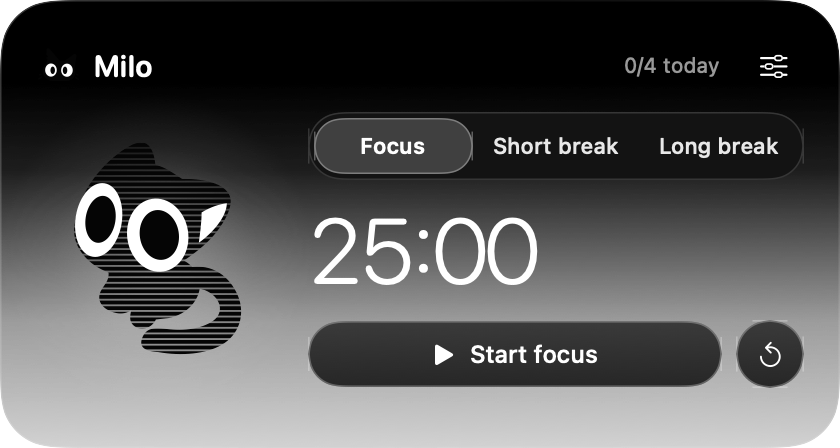

# Milio Pomodoro

A small native macOS Pomodoro companion. The app is called **Milo** and lives in your menu bar with a monochrome cat, a compact landscape timer, and Liquid Glass.



## Features

- Focus, short break, and long break timers with configurable durations and daily goals.
- Local session history, pause/resume, and deadline recovery after sleep or reopening.
- Local completion notifications and optional sound.
- Native glass with adjustable darkness, opaque readable controls, and solid settings.
- A vector cat with breathing, blinking, tail movement, and an optional moving scanline effect.
- A Genie animation that opens from and closes into the menu icon. Click the icon again to dismiss.
- Reduced Motion and Reduced Transparency support. Continuous cat animation pauses while the panel is hidden.

No third-party runtime packages, account, server, or web view are required. Sessions and preferences are stored locally.

## Build and run

Requires **macOS 26 or newer**, the Xcode 26 Swift toolchain, and Python 3. The Python asset tools use only the standard library.

Run from the repository root:

```sh
zsh Milo/Tools/build.sh
open Milo.app
```

The script generates vector paths and icons, builds the executable, and creates an ad hoc signed `Milo.app`. This is a local source build; it is not an Apple-notarized release.

Click the cat in the menu bar to open or close Milo. Right-click for the menu and Quit. While the panel is active, Space starts or pauses the timer, Escape closes the panel, and Command-Q quits.

In Settings, turn **Scanline cat** off to compare the original silhouette. **Animate Milo** controls continuous motion; Reduce Motion also stops it. The small menu icon and notification icon keep their clean silhouette.

Allow notifications when macOS asks. After permission is granted, use **Send test** in Settings to check delivery. macOS controls the notification banner; Milo's icon has a transparent background.

Changing durations applies to the next session. Resetting or switching modes during a running or paused session requires confirmation. Closing the panel keeps the timer running; quitting preserves its deadline and any scheduled completion alert. Breaks start manually.

## Development

```sh
swift test --package-path Milo --scratch-path .build/milo
```

The 14 tests cover timer persistence, pause/resume, exactly-once completion, sleep/relaunch, daily boundaries, daylight saving time, settings changes, break cycles, and Genie geometry.

- `Milo/Sources/Milo/`: native AppKit/SwiftUI interface, vector rendering, notifications, and menu transitions.
- `Milo/Sources/MiloCore/`: timer state and pure animation geometry.
- `Milo/Design/assets/`: editable SVG artwork.
- `Milo/Design/tools/build_assets.py`: regenerates SVG masters.
- `Milo/Tools/generate_vectors.py`: converts SVG geometry into SwiftUI paths.

See [native preview commands](Milo/README.md) for isolated UI snapshots and diagnostics.

## Artwork

The cat vectors were redrawn from supplied character references. The moving horizontal scanlines are rendered with SwiftUI Canvas over the existing vector silhouette, with crisp eyes and a soft radial glow. No MotionSites code or cat assets are included. This is a vector treatment rather than a 3D render.
